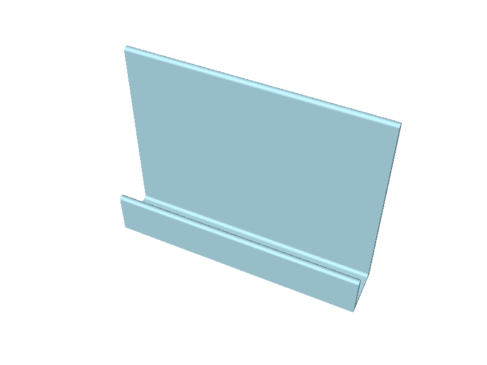
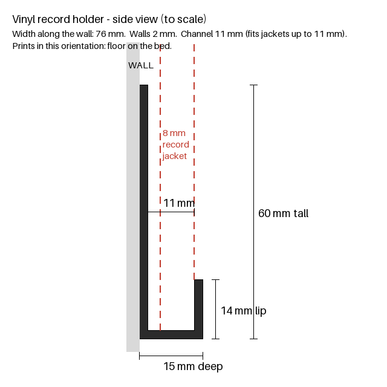

# Vinyl record wall holder — print request

A small black ledge that sticks to the wall with a 3M Command strip. One 12" LP in its
sleeve stands in it and leans back against the wall. **I need 20.**

## What I need
- **20 pieces**, **black PLA**.
- **Looks matter most.** The front of the lip, the underside and the two ends are visible on
  the wall: please no stringing, blobs or seam marks there.
- Print **as the STL is oriented: floor flat on the bed**. Don't stand it on its side or back.
  (Rotating it flat on the bed is fine.)
- The **11 mm channel must stay at least 10.5 mm** — an 8 mm record sleeve has to drop in.

## Settings
| Setting | Value |
|---|---|
| Layer height | 0.2 mm |
| Walls / perimeters | 3 |
| Infill | 15 % |
| Supports | none (no overhangs) |
| Adhesion | no brim, skirt is fine (the bottom edges have a 0.4 mm bevel for elephant's foot) |
| Seam | on the flat back of the tall plate (the side that goes against the wall). Easiest: turn the part so that face points to the rear of the bed and set seam position = Rear. |

## Size
- 15 × 76 × 60 mm (depth × width × height), about **16 g** each, about **320 g** for 20.
- About 1.1 h each on an Ultimaker S3 at 0.2 mm (~22 h for 20); other printers will differ.

## Files
| File | Use |
|---|---|
| `vinyl_holder.stl` | one holder, ready to slice (mm, floor on the bed) |
| `vinyl_holder.3mf` | same, for PrusaSlicer / Bambu Studio / Orca |
| `vinyl_holder.step` | CAD file, if you need to edit it |
| `library_plates/` | pre-arranged plates of 2 / 4 / 6 for the Helsinki library Ultimaker S3, plus `PRINT_AT_LIBRARY.md` |

---

**Lyhyesti suomeksi:** 20 kpl, musta PLA. Ulkonäkö on tärkein: huulen etupinta, pohja ja päädyt
siisteiksi (ei rihmoja, nyppyjä tai saumaa). Tulostetaan STL:n asennossa, pohja alustaa vasten.
0,2 mm kerros, 3 seinämää, 15 % täyttö, ei tukia, ei brimiä. Sauma takalevyn seinänpuoleiselle
sivulle. 11 mm:n uran pitää olla vähintään 10,5 mm. Koko 15 × 76 × 60 mm, n. 16 g / kpl.
